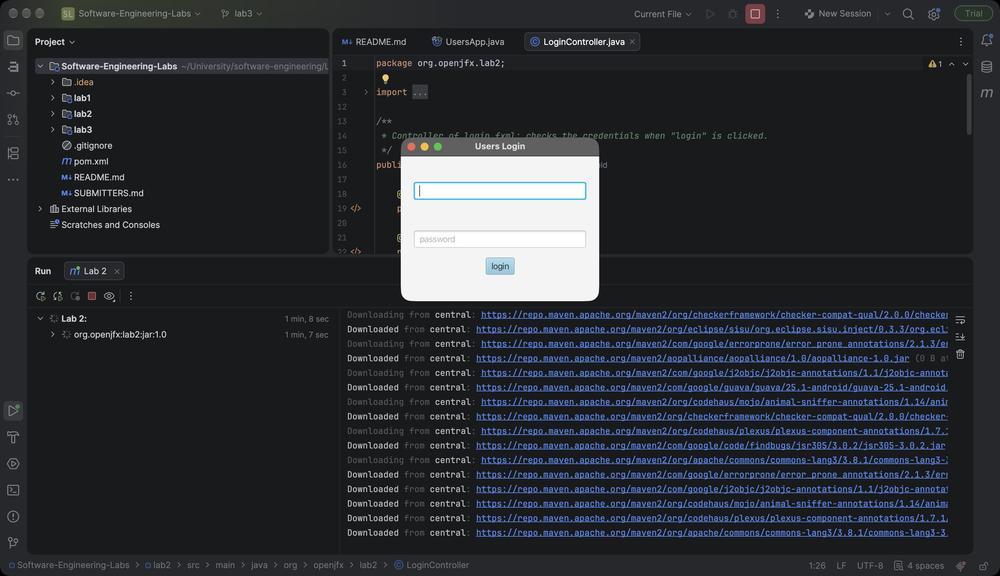
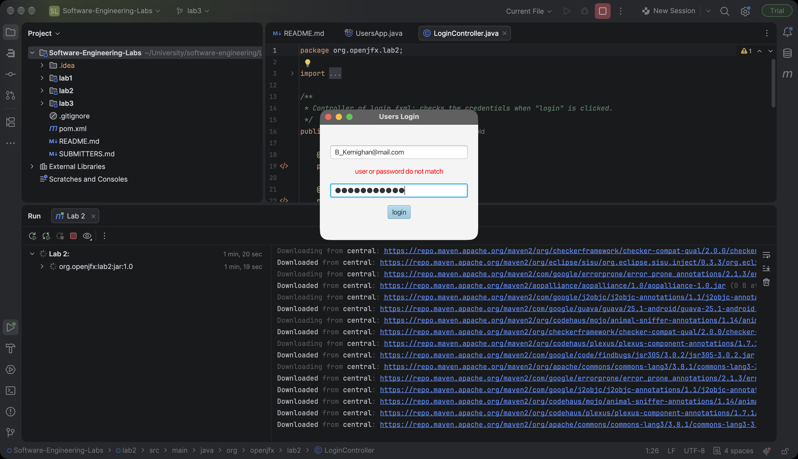
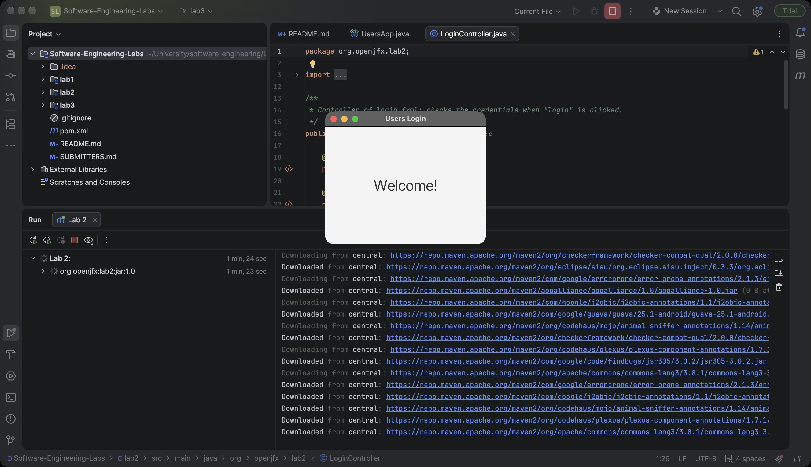

# Software Engineering - Lab 2

A JavaFX login window built on Lab 1's `User` class. The users are loaded from
`users.txt`, and only the valid ones can log in. See [CLASSES.md](CLASSES.md)
for what each class does.

## Run

From this folder (needs a JDK 17+ and Maven):

```sh
mvn javafx:run
```

In IntelliJ, use the Maven tool window: Plugins → javafx → javafx:run.

## Screenshots

| Login screen | Wrong password | Successful login |
|---|---|---|
|  |  |  |
