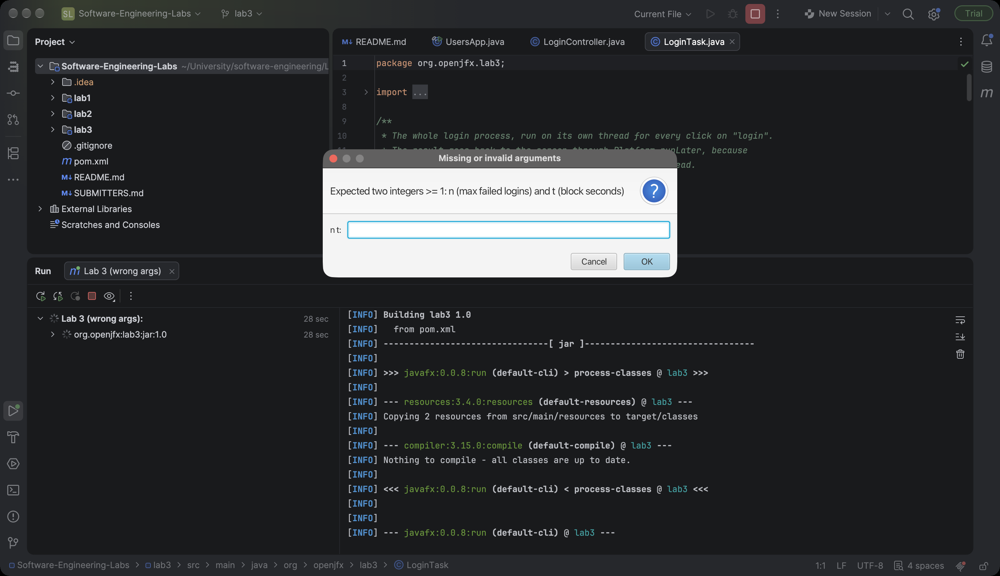
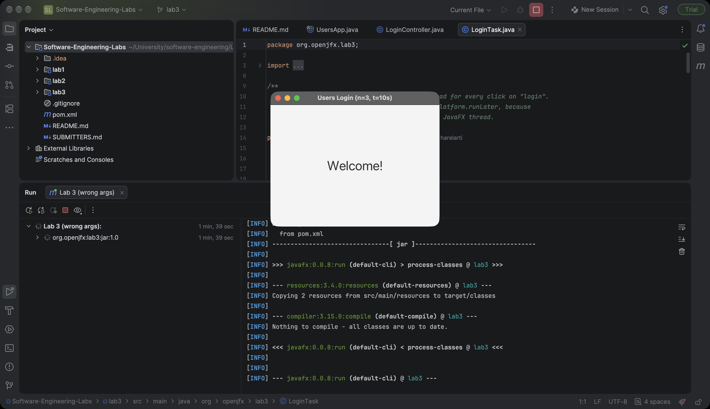
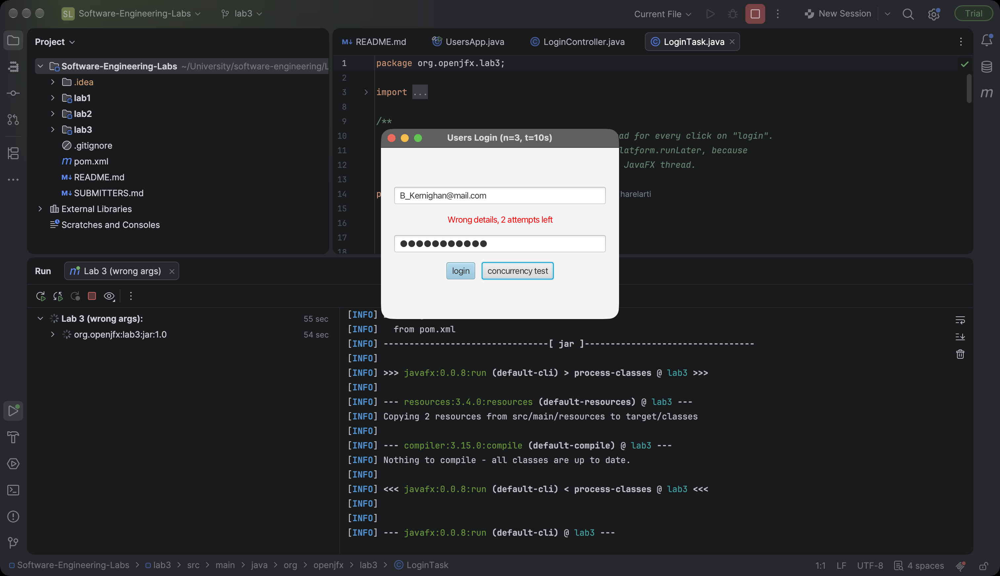
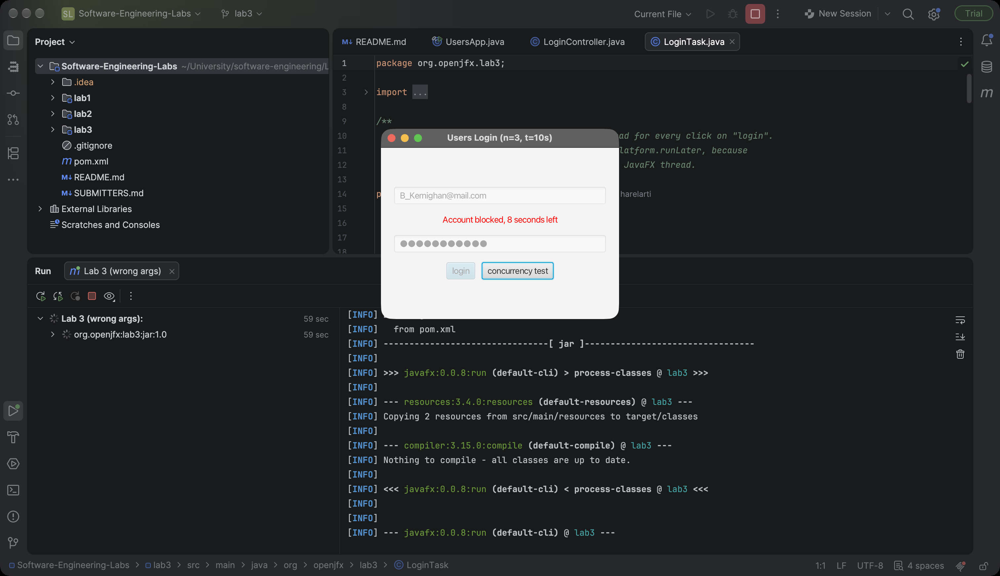
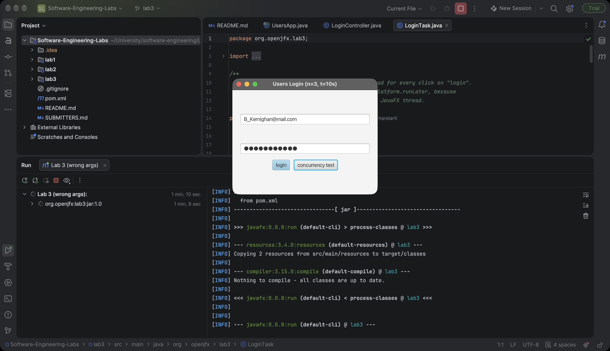
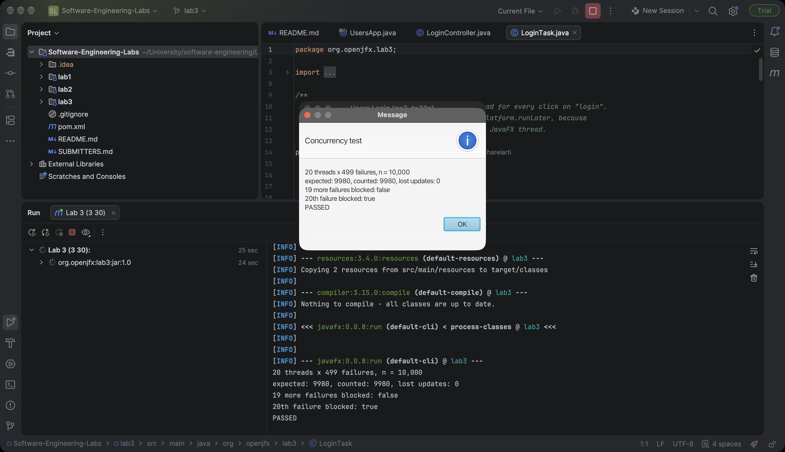

<div dir="rtl">

# מעבדה 3 – חוטים ב־Java: הזדהות מאובטחת

**מגישים:** הראל טימור 329096721, גיא בלומנפלד 331823377

**קישור ל־repo (ענף lab3):** https://github.com/harelarti/Software-Engineering-Labs/tree/lab3/lab3

הרצה (מתוך התיקייה `lab3`): `mvn javafx:run -Djavafx.args="3 30"` (n=3, t=30).
ב־IntelliJ: ‏Run configuration מסוג Maven עם Command line‏ `javafx:run -Djavafx.args="3 30"` (צילומי המסך צולמו כך, עם `3 10`).

## הסבר על כל מחלקה

| מחלקה | תפקיד |
|---|---|
| `App` | נקודת הכניסה. בודקת את n ו־t לפני פתיחת המסך; אם חסרים, לא מספרים שלמים או קטנים מ־1 – מבקשת אותם שוב בחלון קלט. יוצרת את `AttemptTracker`, את תור הכשלונות ואת שני ה־`FailureWorker`, וטוענת את `login.fxml`. בסגירת החלון (`stop`) עוצרת את חוט הספירה לאחור. |
| `LoginController` | controller דק: קורא שדות, משבית אותם, מפעיל חוט חדש עם `LoginTask` ומציג את `LoginResult`. בחסימה מפעיל `CountdownTask`. אין בו לוגיקה של ספירה או זמן. כפתור נוסף מריץ את `ConcurrencyTest`. |
| `User`, `UserLoader` | מעבדות 1–2: `User` מאמת אימייל וסיסמה וזורק `IllegalArgumentException` בקלט לא תקין; `UserLoader` קורא את `users.txt`. |
| `UserState` | מצב של אימייל אחד: מונה כשלונות ושעת סיום חסימה. כל המתודות `synchronized`. כשהחסימה נגמרת המונה מתאפס; כשלון בזמן חסימה לא נספר. |
| `AttemptTracker` | ‏`ConcurrentHashMap` מאימייל ל־`UserState`, מקבל n ו־t בבנאי. `computeIfAbsent` אטומי, כך ששני חוטים לא יוצרים שני מצבים לאותו אימייל. |
| `LoginResult` | תוצאת ההזדהות: הצלחה, שגיאה (עם מספר ניסיונות שנותרו, ‎-1 לאימייל לא קיים) או חסום (עם שניות שנותרו). |
| `FailedAttempt` | אירוע כשלון: אימייל + תור קטן (`ArrayBlockingQueue` בגודל 1) שדרכו ה־`FailureWorker` עונה. |
| `ConcurrencyTest` | 20 חוטים × 499 כשלונות על אותו אימייל עם n=10,000, ואחר כך בודק ש־19 כשלונות נוספים לא חוסמים והעשרים כן. |

## הסבר על כל חוט

| חוט | סוג | מה הוא עושה |
|---|---|---|
| חוט JavaFX | קיים | מציג ומעדכן את המסך בלבד. אין בו קריאת קובץ, sleep או המתנה. |
| `LoginTask` | `Runnable` | נוצר בכל לחיצה. מפעיל `BlockCheckThread` וממתין ב־`join`; אם חסום – מחזיר "חסום" בלי לבדוק סיסמה. אחרת מאמת עם `User` (ותופס את החריגה). הצלחה מאפסת את המונה. כשלון של אימייל קיים: `put` של `FailedAttempt` לתור ו־`take` מהתור הקטן שלו. התוצאה נשלחת ל־controller ב־`Platform.runLater`. |
| `BlockCheckThread` | ירושה מ־`Thread` | בודק כמה זמן חסימה נותר לאימייל. |
| `FailureWorker` ×2 | ירושה מ־`Thread`, daemon | לולאה של `take` מהתור, `recordFailure`, ותשובה ב־`put` לתור הקטן. |
| `CountdownTask` | `Runnable` | כל שנייה: `runLater` עם "Account blocked, X seconds left" ו־`sleep(1000)`. בסוף – מוחק את ההודעה ומפעיל את הכפתור. `interrupt` עוצר אותו כשהחלון נסגר. |

## ניסוי synchronized

עם `synchronized` (הקוד המוגש):
```
20 threads x 499 failures, n = 10,000
expected: 9980, counted: 9980, lost updates: 0
19 more failures blocked: false
20th failure blocked: true
PASSED
```

בלי `synchronized` (הוסר זמנית מ־`UserState` ואז הוחזר), שלוש הרצות:
```
expected: 9980, counted: 8008, lost updates: 1972   20th failure blocked: false   FAILED
expected: 9980, counted: 6100, lost updates: 3880   20th failure blocked: false   FAILED
expected: 9980, counted: 6333, lost updates: 3647   20th failure blocked: false   FAILED
```

## תשובות לשאלות

**1. למה אסור להמתין t שניות על חוט ה־JavaFX?**
חוט ה־JavaFX הוא היחיד שמצייר את המסך ומטפל באירועים (לחיצות, הזזת חלון). אם הוא ישן t שניות, החלון "קופא": לא מתעדכן, לא מגיב ללחיצות, אי אפשר להזיז או לסגור אותו, ו־macOS מציג גלגל המתנה. אצלנו כל המתנה (`join`, `take`, `sleep`) נעשית בחוטים אחרים (`LoginTask`, `CountdownTask`), וחוט הממשק רק מקבל עדכונים קצרים דרך `Platform.runLater`.

**2. איזו בעיה עלולה לקרות ב־recordFailure בלי synchronized?**
`failures++` אינו פעולה אטומית: קריאה, הוספה וכתיבה. שני חוטים יכולים לקרוא את אותו ערך (למשל 500), שניהם כותבים 501, ועדכון אחד אובד (race condition). בניסוי שלנו, בלי `synchronized` נספרו רק 6,100–8,008 מתוך 9,980 כשלונות (עד 3,880 עדכונים אבדו), ולכן הכשלון ה־20 לא חסם – כלומר תוקף יכול לקבל יותר מ־n ניסיונות. עם `synchronized` נספרו בדיוק 9,980 והחסימה הגיעה בדיוק בזמן. בנוסף, בלעדיו בדיקת "האם חסום" ועדכון שעת החסימה יכולים להתערבב בין חוטים.

**3. למה BlockingQueue ולא ArrayList עם busy wait?**
‏`ArrayList` אינו thread-safe: הוספה והוצאה במקביל עלולות לאבד איברים או לזרוק חריגה, וצריך לסנכרן אותו ידנית. לולאת busy wait (`while (list.isEmpty()) {}`) שורפת מעבד כל הזמן בלי לעשות כלום. ב־`BlockingQueue` הפעולה `take()` מרדימה את החוט עד שמגיע איבר, ו־`put()` מעירה אותו – סנכרון מובנה, בלי בזבוז מעבד. אותו רעיון בתור הקטן: `LoginTask` ישן ב־`take` עד שה־`FailureWorker` עונה.

**4. למה Runnable או ירושה מ־Thread לכל חוט?**
- `LoginTask` – ‏`Runnable`: זו משימה ולא חוט; היא מקבלת נתונים ומחזירה תוצאה, ואפשר להריץ אותה בכל חוט או במאגר חוטים, והמחלקה נשארת חופשית לרשת ממחלקה אחרת.
- `BlockCheckThread` – ירושה מ־`Thread`: חוט קצר עם מטרה אחת, ש־`LoginTask` מפעיל וממתין לו ב־`join`, ואז קורא את התוצאה מהשדה שלו. הירושה נותנת `start`/`join` ישירות על האובייקט.
- `FailureWorker` – ירושה מ־`Thread`: חוט עובד ארוך־חיים עם שם ו־`setDaemon(true)` שמוגדרים בבנאי, כך שהוא עצמו "החוט".
- `CountdownTask` – ‏`Runnable`: משימה שמעדכנת את המסך; ה־controller עוטף אותה ב־`Thread` משלו, שומר אותו כדי לעשות לו `interrupt`, ומגדיר אותו daemon.

## צילומי מסך

(א) ארגומנטים שגויים (`3 abc`) – בקשה להזין n ו־t שוב:



(ב) הזדהות מוצלחת:



(ג) שגיאה עם מספר ניסיונות שנותרו:



(ד) חסימה עם ספירה לאחור (השדות והכפתור מושבתים):



(ה) שחרור אחרי t שניות – ההודעה נעלמה והכפתור פעיל:



בדיקת המקביליות (כפתור concurrency test):



</div>
